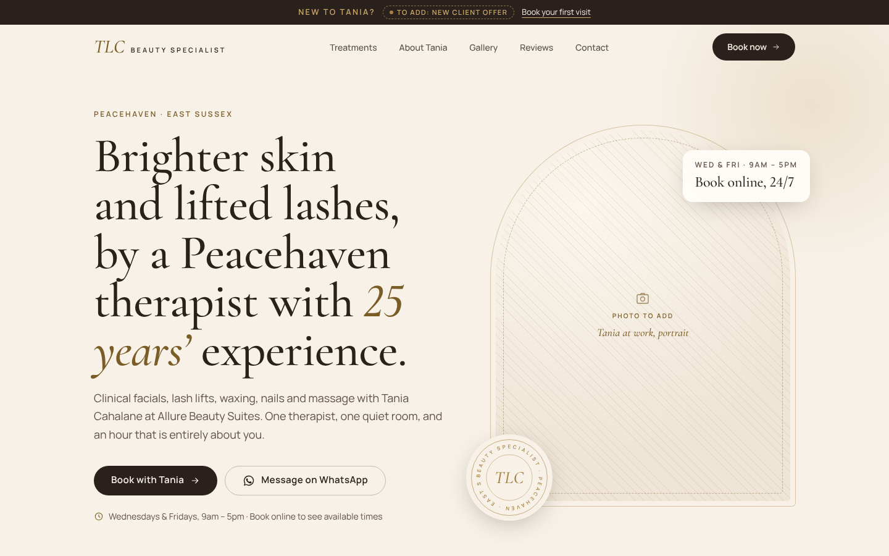
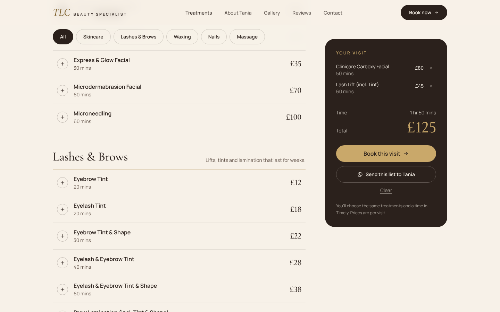
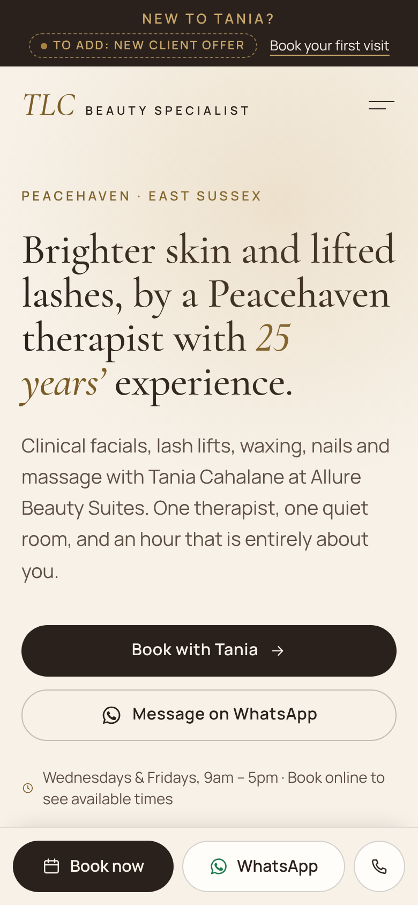

# Case study: TLC Beauty Specialist, Peacehaven

**Client:** Tania Lena Cahalane, a beauty therapist with 25+ years' experience, NVQ Level 2 & 3
**Location:** Allure Beauty Suites, Peacehaven, East Sussex
**Live site:** [ADD LIVE LINK]

## The problem
Tania is a highly experienced one-person business, but online she looked like every other salon. Her prices and booking lived on a booking platform, there was no site that showed who she is, and local rivals with bigger review counts showed up first. Clients had no easy way to see the full menu, work out what a visit would cost, or understand why she is worth choosing.

## What we built
- **A site that books appointments.** Every page leads to Tania's Timely booking. On phones, a sticky bar keeps **Book now**, **WhatsApp** and **Call** one tap away.
- **"Build your visit" price menu.** Clients tap treatments from the full list of 43 and see the total time and price add up as they go. They can then book, or send the list straight to Tania on WhatsApp.
- **Built around Tania herself.** The headline sells the result ("Brighter skin and lifted lashes, by a Peacehaven therapist with 25 years' experience"). Her qualifications, years of experience and one-to-one service sit near the top of the page.
- **A look that's hers alone.** Cream and antique gold, arched photo frames and a "TLC" seal designed for the brand. Nothing comes from a template.
- **Before/after slider and reviews carousel** to show real results.
- **Set up for local search.** The site is marked up as a beauty salon for Google, with opening hours, prices and an FAQ. Page titles target Peacehaven, Newhaven, Saltdean, Rottingdean, Telscombe, Seaford and Brighton, and the site has a sitemap and link previews for social media.

## The numbers
| Google Lighthouse score (out of 100) | Mobile | Desktop |
|---|---|---|
| Performance | 91–99 | 100 |
| Accessibility | 100 | 100 |
| Best practices | 100 | 100 |
| SEO | 100 | 100 |

*Measured on every page before launch. Business results, such as bookings and enquiries in the first 60 days, will be added here once real figures are in.*

## What the owner gets
- A site she can update without a developer: prices, photos and reviews each live in one simple file.
- Hosting on Vercel's free plan, plus automatic deploys from GitHub.
- A plain-English guide for adding photos, reviews and offers.

**Want one like this for your business?** [YOUR NAME] · [YOUR EMAIL] · [YOUR PHONE]
